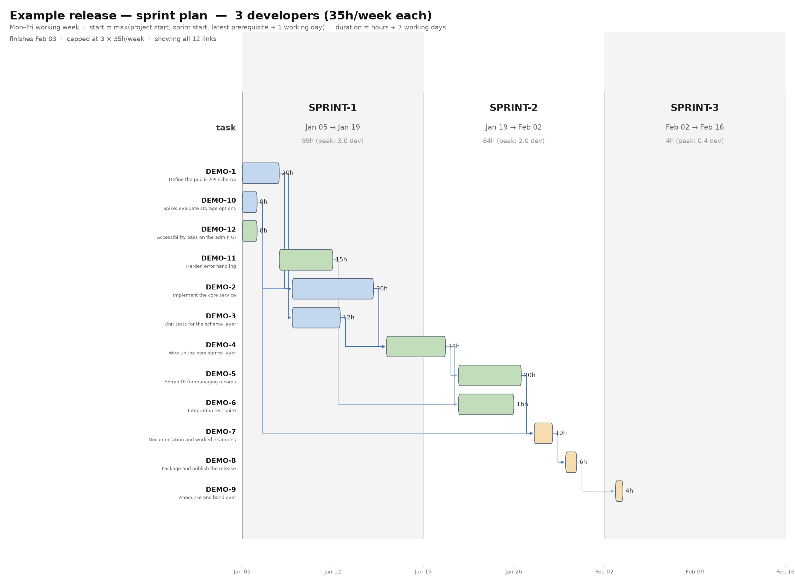

# Sprint Gantt with precedence links

Render a sprint-level Gantt chart from a Jira CSV export, showing when each
task runs and which tasks block which — with real calendar dates, a Monday to
Friday working week, and optional headcount limits.



## What it does

Given a Jira export of a set of tasks (an Epic, or any saved filter), it
produces a PNG where:

- the **x axis is real calendar time**, and each sprint is a fixed-length column
- each task is a **bar whose length is its estimated duration**, not its sprint
- **arrows** run from each blocker to the task it blocks, drawn orthogonally
  (horizontal and vertical segments only)
- each sprint header shows the **hours actually spent inside that sprint**,
  apportioned by working days, so work that spills across a boundary is billed
  to the sprint that consumes it
- and the **peak headcount** that sprint needs on its busiest day, which can be
  fractional: a task occupying a whole working day counts as one person, while
  one that starts or finishes part way through a day counts as a fraction

## Requirements

- Python 3.12+
- [uv](https://docs.astral.sh/uv/) for the environment

`make` is optional; you can call the script directly.

## Setup

```bash
uv sync --frozen        # or: make setup
make demo               # render the bundled example - no export needed
```

`make demo` renders the synthetic dataset in `docs/`, so it works immediately
from a fresh clone and doubles as a smoke test. The other targets need a real
export (see [Usage](#usage)).

Dependencies are pinned in `uv.lock`, so this reproduces the exact environment.
Recipes run through `uv run --frozen`, which fails loudly if `uv.lock` and
`pyproject.toml` ever drift apart rather than silently re-resolving.

## Usage

Export your tasks from Jira as CSV, drop it beside the script, then:

```bash
make                 # all six charts
make planned         # sprints exactly as planned in the export
make capped          # rebalanced, limited to 3 developers
make unlimited       # rebalanced, no headcount limit
```

The three charts isolate two independent choices:

| Comparison | Shows |
|---|---|
| `planned` vs `unlimited` | the effect of **rebalancing** the sprints |
| `unlimited` vs `capped` | the effect of the **headcount** limit |

Each also has a `-simple` variant that draws only each task's
latest-finishing predecessor (`--edges latest`) instead of every blocking
link, which reads as a single chain when the full dependency web is too busy:

```bash
make capped-simple
make capped PEOPLE=5     # same chart, five developers
```

Or drive it directly:

```bash
uv run python gantt.py --title "My Epic - plan" -o chart.png
uv run python gantt.py --title "My Epic - plan" --assignment rebalance \
                       --people 3 --edges latest -o chart-rebalanced.png
```

### Options

| Option | Meaning |
|---|---|
| `--title` | **required** — the chart title, since it is project specific |
| `--csv` | export to read (default: newest `*.csv` beside the script) |
| `--config` | TOML config (default: `gantt.toml` beside the script) |
| `--assignment csv` | keep the sprint each task is assigned to in the export (default) |
| `--assignment rebalance` | pull each task as early as its dependencies allow |
| `--edges all` | draw every blocking link (default) |
| `--edges latest` | draw only the predecessor that actually gates each task |
| `--people N` | cap concurrency at N developers (`make capped PEOPLE=N`) |
| `--version N` | version label appended to the title |
| `-o` | output path |

## Configuration

Project-specific settings live in `gantt.toml`, which is **gitignored** so that
issue keys, sprint names and dates never enter the repository. Copy the
committed example and edit it:

```bash
cp gantt.toml.example gantt.toml
```

```toml
title = "My Epic - sprint plan"

# nothing starts before this date (useful when the team starts mid-sprint)
project_start = "2026-01-05"

# tasks to leave out of the chart entirely
skip = ["KEY-1", "KEY-2"]

# force a task into a different sprint than the export says
[sprint_override]
"KEY-3" = "SPRINT-A"
```

`title` is read by the `Makefile` and passed to the script as `--title`, so you
do not have to repeat it. Everything else is optional.

The config file can also override the scheduling policy (see
`gantt.toml.example`), which defaults to a five-day week of seven-hour days
with a one-working-day gap between dependent tasks.

## Scheduling model

```
start    = max(project start, sprint start,
               latest prerequisite finish + lag working days)
duration = estimated_hours / hours_per_day      (measured in WORKING days)
```

Work happens **Monday to Friday**; weekends are non-working, so a task that
starts on a Friday and runs a working day continues on Monday, leaving a
visible weekend gap in the chart. That is one working day of lag, not three
calendar days of idle time.

Two assignments are available:

- **csv** — whatever sprint each task carries in the export. Tasks idle until
  their sprint begins, even if their dependencies finished earlier.
- **rebalance** — every task is pulled as early as its dependencies permit,
  then labelled with the sprint it actually starts in. This removes
  sprint-boundary waits, and can finish the work earlier when the export's
  assignment is not aligned to the dependency graph.

`--people N` caps how many tasks may run at once. A running task occupies one
person, and a person supplies `days_per_week × hours_per_day` hours per week,
so N people means at most N concurrent tasks on any working day.

## Input format

A Jira CSV export. The parser reads these columns:

| Column | Used for |
|---|---|
| `Issue key` | task identity and link endpoints |
| `Summary` | the row label |
| `Sprint` | sprint name and start date, parsed from `NAME (YYYY-MM-DD)` |
| `Original Estimate` | duration, in seconds |
| `Outward issue link (Blocks)` | precedence links |

Jira repeats the `Sprint` and `Outward issue link (Blocks)` headers once per
multi-value slot, which the parser handles.

Notes:

- Tasks blocking a key that is not in the export have those links dropped, with
  a warning on stderr — they cannot be scheduled.
- A task with more than one sprint is placed in its earliest.

## Layout

| File | |
|---|---|
| `gantt.py` | chart rendering |
| `schedule.py` | CSV loading and the scheduling model |
| `gantt.toml.example` | configuration template |
| `Makefile` | convenience targets |
| `pyproject.toml`, `uv.lock` | pinned environment |

## License

MIT — see [LICENSE](LICENSE).
